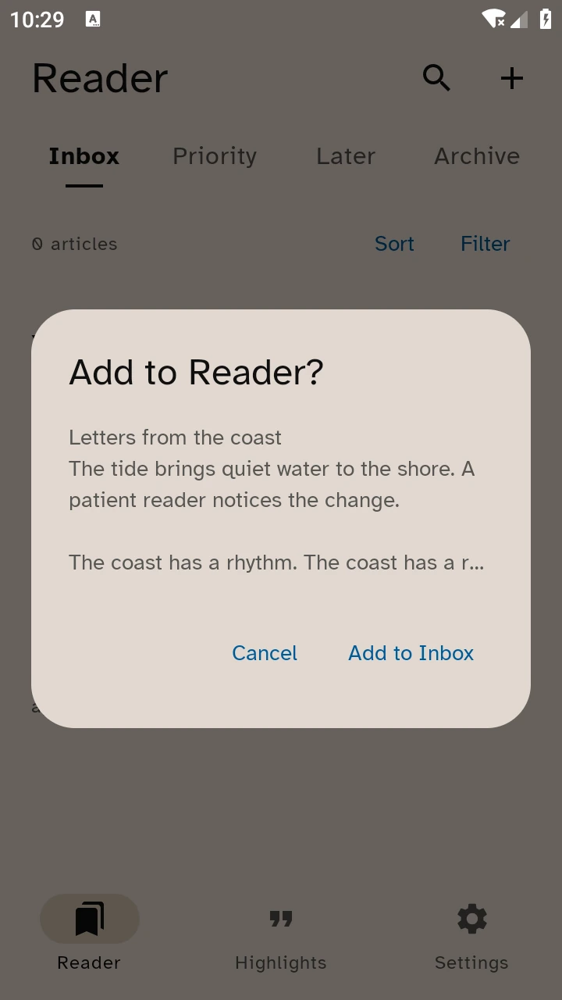
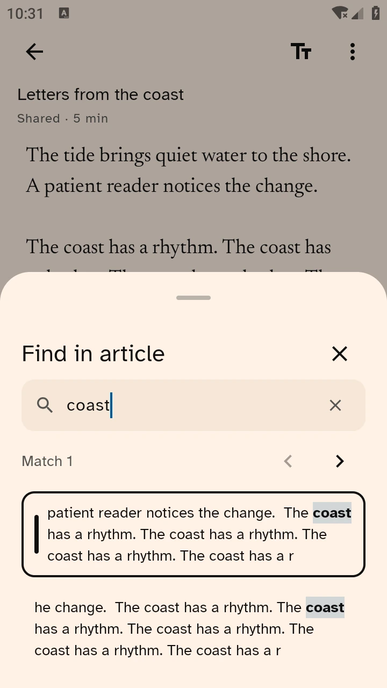
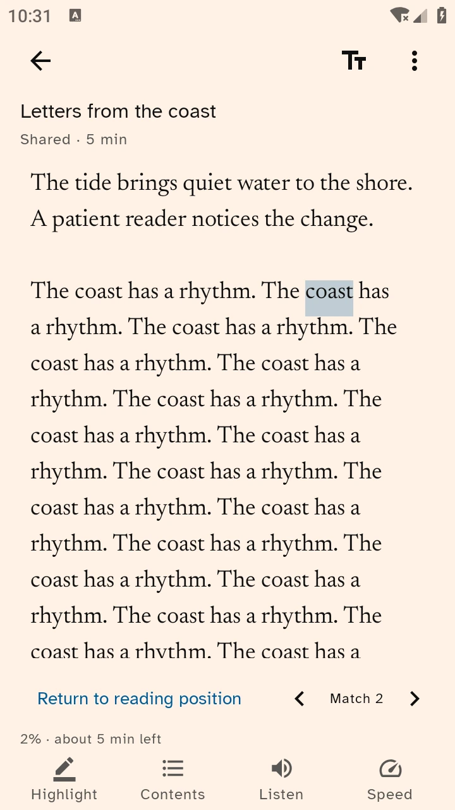
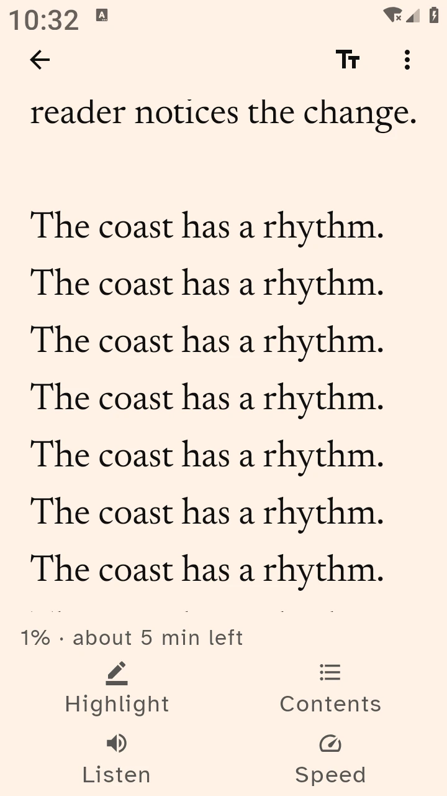

# Nostr Reader quality review · 26 November 2026

The review follows an article from an external share or the Chrome toolbar into offline storage, through reading and annotation, and back to the saved position. The acceptance criteria are that a save has a durable result, network activity respects the user's choice, and opening or searching a passage does bounded work where possible.

The integration base is `codex/reliability-finalize` at `c46acef`, the November TCL-tested branch, 122 commits ahead of `main`. Its database is Room v13. The independent October improvement branch has a different v9 schema. This change preserves the November upgrade path. It also carries forward the archived highlight-journal, pen, playback and editable-provider-control fixes, and the public-address policy from the security branch. Installing a build over an independent October database needs its own migration test.

## Findings and repairs

| Priority | What could go wrong | Change and verification |
| --- | --- | --- |
| High | Two concurrent shares could both create active fetches. A callback from an older attempt could change the state of a newer attempt. | Room now performs lookup and insertion in one transaction. Each claim owns a generation, respects the retry deadline and checks ownership before committing. Twelve simultaneous shares of the same URL converge on one request. Tests also cover stale failure, cancellation, process interruption and a manual retry. |
| High | An exported Android share intent could start importing or fetching immediately. A proxy could resolve the final network destination outside Reader's address checks. | Reader shows the shared subject and a bounded preview before import. Accepting an external share now costs one tap. Capture validates the route at each redirect. Capture and relay connections support verified direct routes and reject a required proxy. Temporary DNS failure remains retryable. Network logs omit unexpected exception text from capture failures. |
| High | Pending Chrome captures kept the compressed article in the record used for status and publication checkpoints. A late write or partial enqueue could lose the deduplication relationship. | A dedicated outbox module owns IndexedDB v4. It migrates pending chunks into a separate store in one version-change transaction. Enqueue writes the article, delivery state and capture identity atomically. Settlement deletes the pending data and records the outcome together. Tests exercise v2 and v3 upgrades, quota rollback, restart, duplicate receipt, export and authenticated acknowledgement. A replay after deleting a legacy recovery copy now reports its recorded delivery or discard. |
| High | Dependency checks flagged the extension sanitizer/build chain and a transitive Android Guava version. | Updated the npm lockfile and constrained Media3's Guava dependency to the patched Android artifact. The full npm audit reports zero known advisories. The OSV version query found zero matches among 170 resolved Maven coordinates and 30 crates after the update. This check covers published advisories at review time. |
| Medium | Unpaired Android sessions woke every second, touched Room and refreshed sync health. Service failures could repeatedly wake a paired device. | The foreground receiver observes whether a channel is active or pairing. With no eligible channel it waits for a database change. Pairing wakes it immediately. Repeated failures use bounded exponential backoff. WorkManager still handles scheduled background work. |
| Medium | Find materialized a snippet and cursor for every occurrence before rendering. Library search also followed that path to locate just one hit. | Find holds up to 100 results and one continuation. Next and Previous cross page and section boundaries. Library search stops at its first hit. Tests compare every hit across four sections and cover the exact page-size boundary. Opening Find focuses the keyboard field. Return to reading position restores the passage after inspection. |
| Medium | Heavily annotated passages rescanned every highlight for each style boundary. Building a grapheme index allocated boxed offsets even for ASCII prose. | Highlight painting uses a priority queue ordered by timestamp and ID. Monochrome underlines build native geometry only for the viewport and one screen on either side. The drawing test compares wrapped and mixed-direction geometry against the full-layout result. The pen release path retains the last adjusted range across finger-up and recognizes a saved selection if Android restores it after acknowledgement. A seeded test compares 1,200 overlapping marks with the prior visible-color rule at every offset. ASCII text uses identity offsets and mixed text uses a bitmap plus one boundary-iterator pass. Tests include combining marks, flags, joined emoji and CRLF. |
| Medium | Counting protocol words created token lists and pattern matchers per word during imports and transfer verification. | Reuse a token cursor and compare offsets in the original line. Differential tests preserve fence, URL, list-marker and whitespace behavior across mixed scripts. The receiver still validates the sender's count. |
| Medium | Non-UTF-8 pages could arrive as damaged text. Local anchors were discarded before the reader could follow them. A failed article open could strand the user on an error. | Extraction honors the declared HTTP charset or document metadata. The parser preserves same-document anchors. Fragment lookup reads each bounded section once and handles escaped names. Article and search failures have retry actions. Theme changes update link ink on the existing native text. Web links, section anchors and footnotes expose Android clickable spans and use the same destination checks as touch. |
| Medium | Receipt history retained source URLs after delivery. A failed pairing-status request or a late response after Cancel could leave misleading controls. | New receipts omit URLs. Existing receipt URLs and expired records are trimmed on worker startup. Pairing invalidates stale requests, recovers from transient status failure and offers the manual code if QR rendering fails. The capture preview supports Escape and restores focus to the page. |

## Measured work

These are isolated host-JVM timings on JDK 17. Each cell measures the same input and verifies the same resulting offsets or word count. App launch, scrolling, display refresh and battery use require separate measurements.

| Operation | Before | After |
| --- | ---: | ---: |
| Build selection boundaries and make two lookups, 196,600 ASCII UTF-16 units | 11.64–13.78 ms | 0.167–0.168 ms |
| Same operation on 196,600 units of mixed European text and joined emoji | 9.21–10.86 ms | 6.28–6.45 ms |
| Count 190,650 words in 1,048,575 UTF-16 units | 45.75 ms | 36.72 ms |

The boundary ranges are the medians of two fresh JVM runs per build, ordered before/after/after/before, with eight warmups and 21 samples per run. Word count used four warmups and 11 samples per build. For the outbox, the stronger check is structural. After migration, status and duplicate lookup read the payload store zero times. Export reads it once and returns the original Markdown.

## Reading experience on Android

The API 28 emulator ran the installed app with a synthetic article on a 360 dp wide viewport. Cancelling an external share kept the empty Inbox at zero. Accepting the same share saved the article. Find accepted typing on entry, showed the first result and moved to the second in the reading surface. Returning from Find restored the reading location. Focus mode hid the controls. At 160% system text the dock wrapped, and the search field remained reachable and focused.

| Share confirmation | Find in article | Navigate a hit | System text at 160% |
| --- | --- | --- | --- |
|  |  |  |  |

## Verification and release plan

1. **Host checks.** Android passed 297 JVM tests, lint, both debug APK builds and native-library 16 KiB alignment. Lint retains nonfatal warnings, including touch-listener accessibility and RTL gravity in the native reader. Chrome passed 186 tests, type checking and the production package check. Rust passed six tests. The Swift reference suite passed on macOS in GitHub Actions.
2. **Installed behavior.** Chrome for Testing ran the packaged MV3 extension in a disposable profile. Its native settings entry point, unpaired capture, duplicate detection, export, settings reload, discard and terminal replay were exercised. The Android workflow now runs capture, migration, transfer, search, highlight and playback instrumentation on an API 34 emulator, including a 19 MiB transfer. Successful CI runs retain the QA APK and matching unpacked Chrome extension for 14 days. The QA package installs alongside production. An in-place upgrade of an existing QA installation needs its original signing key. Two system-speech lifecycle tests require a device with a voice and the explicit speech-test flag.
3. **Physical release acceptance.** Compare this branch with the November build on the TCL and a conventional Android phone. Use identical saved articles and measure cold open, first readable frame, Find latency and frame-time distribution while scrolling a dense highlighted passage. Check the device's physical pen handles and e-ink refresh modes, TalkBack navigation, and the installed TTS engine across a section boundary and screen lock. On a paired Chrome/phone setup, interrupt delivery, reconnect, and verify a single offline article and its authenticated acknowledgement before promoting the build.

Daybreak reported this workspace ineligible for its hosted scans. Security evidence here comes from defensive source review, dependency checks, transaction and protocol tests, and installed-app behavior. The PR is a review branch for the next device build.

[Pull request and checks](https://github.com/mariusschober/nostr-reader/pull/2)
